<!-- dynamic typing effect 动态打字效果 -->

 [][juejin]   

I'm **Zane**. I am an creative front-end web developer currently based in Beijing. Reach out to me on wechat if you'd like to talk ✌️

<!-- ## 💻 Open Source Work Stats -->

<!--
 https://github-readme-stats.vercel.app/api?show_bg=1&username=Fxxk181126&show_icons=true
-->

  
<h2>🛠️ My Favorite Software and Tools</h2>

  

      
      
      
      
      
      
  

  

      
      
      
      
      
      
  

[juejin]: https://juejin.cn/user/1574920986563927 '掘金'
[1]: https://www.zhihu.com/people/Fxxk181126
[2]: https://segmentfault.com/u/Fxxk181126
[3]: https://www.v2ex.com/member/Fxxk181126
